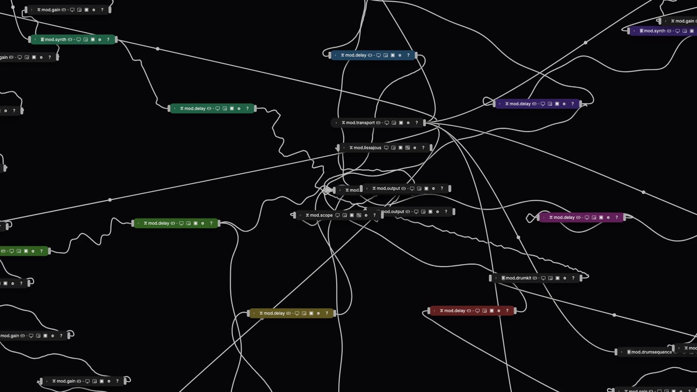
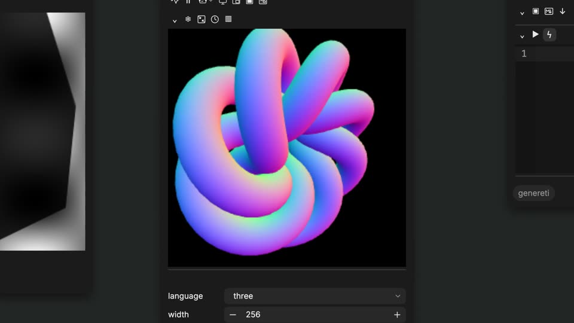
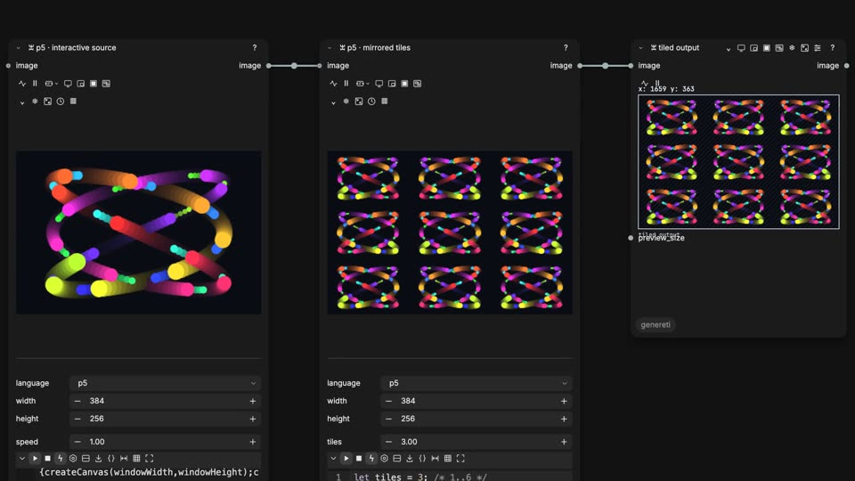
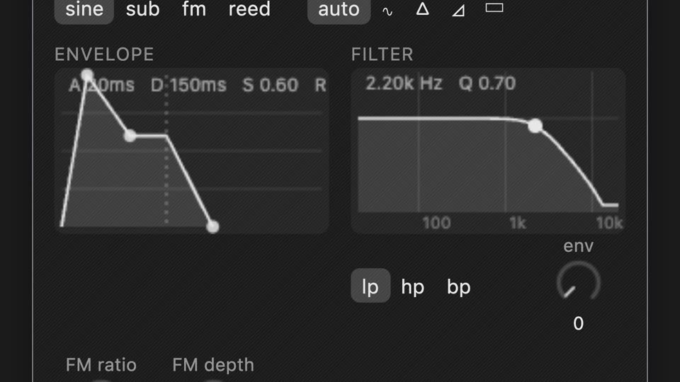
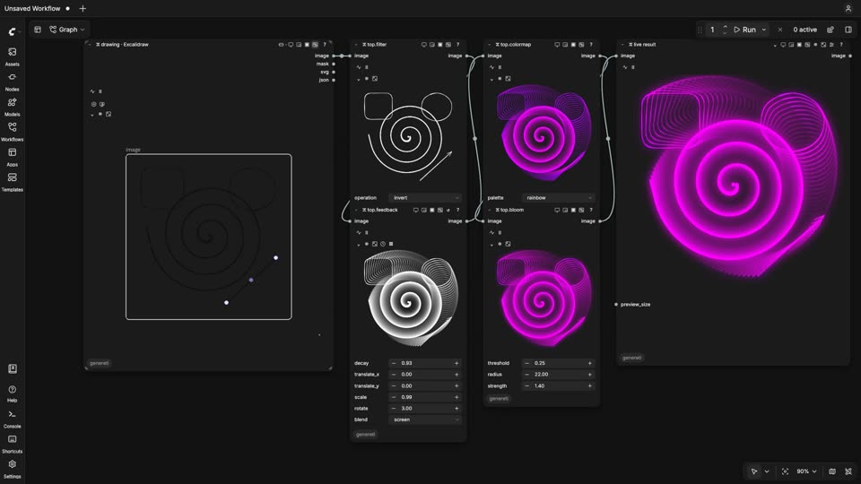
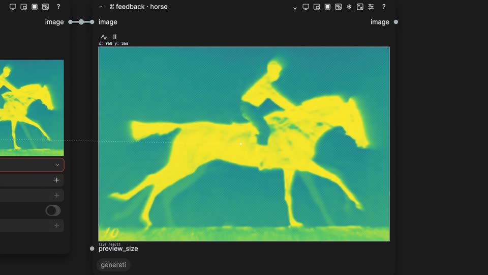
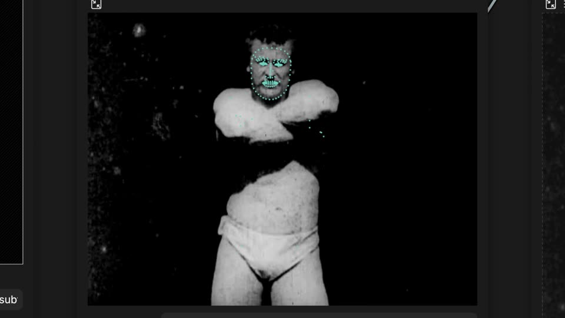
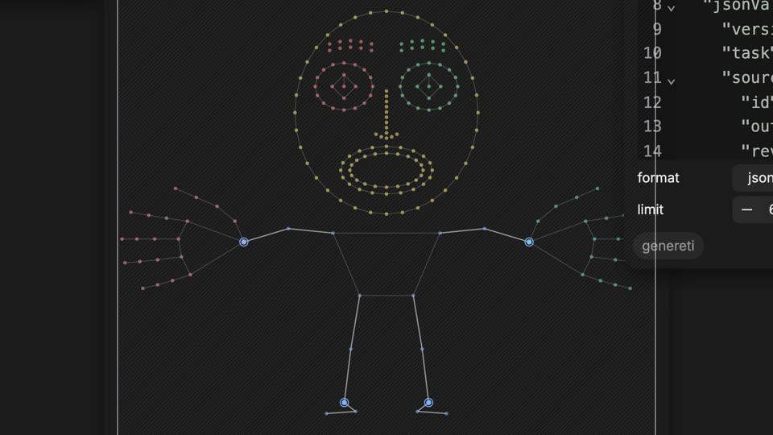
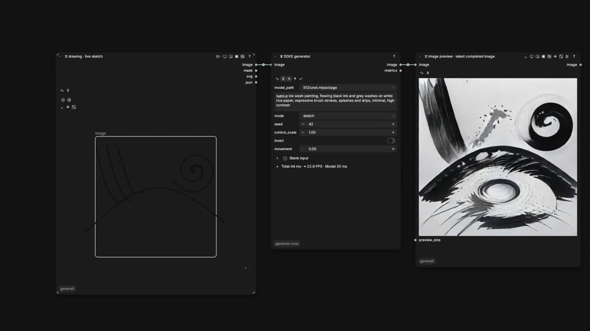

# ꘇ Genereti

**Live visuals, sound and code, as ComfyUI nodes.** Genereti is an open-source node pack that turns ComfyUI into an instrument: you type code, draw, patch sound or play a film, and the graph answers live, every frame, in your browser.

[](https://languel.github.io/genereti/)

▶ **[Watch the 1-minute demo](https://languel.github.io/genereti/)** · MIT licensed · 100+ nodes · 40+ example workflows · no model downloads needed

> **Early alpha.** Built for classroom use and live performance. Expect bugs and changing interfaces, and back up your workflows before updating.

## What you can do

<table>
<tr>
<td width="50%"><br><b>Livecode.</b> p5, GLSL shaders, Three.js, tixy, HTML, SVG, LaTeX and more, edited inside a node and running live.</td>
<td width="50%"><br><b>Chain sketches.</b> One sketch's output wires into the next, like any ComfyUI image.</td>
</tr>
<tr>
<td><br><b>Modular audio.</b> Transport, sequencers, drum kit, synths, filters, delays and a mixer, all in the browser.</td>
<td><br><b>Drawing.</b> Excalidraw and Poliplan as nodes; every stroke drives the effects downstream.</td>
</tr>
<tr>
<td><br><b>Media and textures.</b> Videos, GIFs and images through feedback, colormaps, bloom, displacement and other texture operators.</td>
<td><br><b>Perception (optional).</b> MediaPipe pose, hands and face on a film or camera, as data you can wire anywhere.</td>
</tr>
<tr>
<td><br><b>Pick body regions.</b> Choose wrists, torso, lips or eyes and turn their motion into drawing, sound or events.</td>
<td><br><b>GeneretiCore (separate, experimental).</b> Local models on Apple silicon that answer your drawing live. <a href="https://github.com/languel/genereticore">Its own repo</a>; not needed for Genereti.</td>
</tr>
</table>

Also: a performance timeline with shared musical time, webview pages for notes and math, image compare views, and an optional assistant. Archival footage above: Muybridge (1887), Edison's *Sandow* (1894); both public domain.

## Quick start

You need a recent ComfyUI and a browser with WebGPU (recent Chrome or Edge). The standard demos need **no model downloads, separate model server or extra node packs**.

1. Install **ꘇ Genereti** from ComfyUI's **Manager / Extensions**, then restart ComfyUI and refresh the browser.

   Or install from GitHub: stop ComfyUI, then from your ComfyUI directory run

   ```sh
   git clone https://github.com/languel/genereti.git custom_nodes/genereti
   ./.venv/bin/python -m pip install -r custom_nodes/genereti/requirements.txt
   ```

   (use ComfyUI's own Python; see the [installation guide](docs/comfy-distribution.md) for Windows, Portable and Desktop).
2. Restart ComfyUI and refresh its browser page.
3. Open **Workflows → Genereti** (or **Templates → genereti**). Sound starts when you press ▷ on a `mod.output` node.

### Good first workflows

| Try | What you will see |
|---|---|
| **ꘇ-Performance-Timeline** | the tour: visuals, sound and a timeline (**Alt+Shift+T** opens it) |
| **ꘇ-Livecode-Languages** | six languages side by side; edit any of them |
| **ꘇ-Livecode-P5-Pipeline** | a p5 sketch feeding another sketch |
| **ꘇ-Modular-Audio** | a small synth patch to play with |
| **ꘇ-Neuron-Dance** | a generative music video built from nodes |
| **ꘇ-Painterly-Feedback-Patch** | texture operators painting with feedback |
| **ꘇ-Perception-01-Streams** | MediaPipe on a film (downloads its browser model on request) |

Next steps: the [student quickstart](docs/student-quickstart.md), the [livecode tutorials](docs/livecode-tutorials.md) and the [full list of workflows](docs/workflows.md).

## Learn more

- [Documentation index](docs/README.md): every guide, by area
- [Node catalog](docs/opentouch-catalog.md) · [Modular audio](docs/modular-audio.md) · [Performance timeline](docs/performance-time.md) · [Keyboard shortcuts](docs/shortcuts.md)
- [Contributing and repository layout](docs/contributing.md)

## License

Original Genereti code is MIT licensed. Bundled dependencies keep their own licenses and notices; see [licensing](licensing/README.md).
